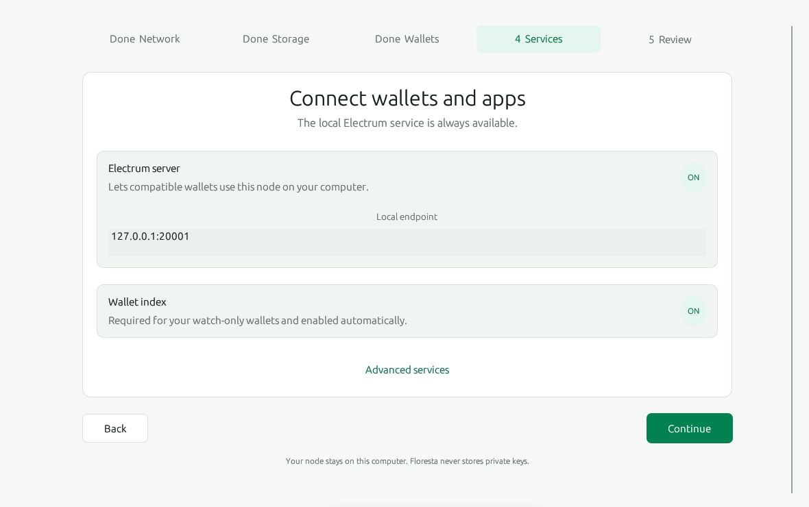
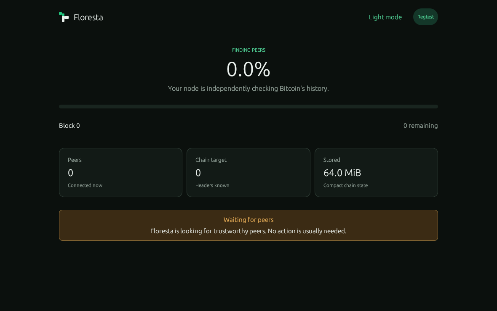

# Floresta Desktop

A friendly, native desktop application for running a compact, independently verifying Bitcoin node with [Floresta](https://github.com/getfloresta/floresta).

[](https://github.com/getfloresta/floresta-desktop/actions/workflows/ci.yml)
[](#license)

Floresta Desktop embeds the node, guides you through configuration, and keeps sync status, peers, wallet services, and important activity in one place. No separate daemon or configuration file is required.



## Highlights

- **Verify Bitcoin yourself** — run an embedded Floresta node instead of relying on a wallet provider or block explorer.
- **Compact chain state** — validate accepted blocks with Utreexo and prune raw block data after use.
- **Guided setup** — choose Mainnet, Testnet4, Signet, or Regtest; configure storage, wallets, privacy, and local services.
- **Watch-only wallets** — import output descriptors or extended public keys. Floresta Desktop does not store private keys.
- **Wallet connectivity** — serve Electrum locally, with optional Electrum TLS and JSON-RPC endpoints.
- **Clear node status** — follow verification progress, peer connections, service state, and session activity.
- **Privacy controls** — use direct Bitcoin connections or route node traffic through an existing Tor SOCKS5 proxy.
- **Native and cross-platform** — built in Rust for Linux, macOS, and Windows, with light and dark themes.



## Get Floresta Desktop

### Download a release

Prebuilt archives for Linux x86-64, macOS, and Windows x86-64 are attached to each [GitHub release](https://github.com/getfloresta/floresta-desktop/releases). Download the archive for your platform, verify it against the accompanying `.sha256` file, extract it, and launch `floresta-desktop` (`floresta-desktop.exe` on Windows).

Release publishing requires a committed `Cargo.lock` and a tag matching `v` followed by the `[package].version` in `Cargo.toml` (for example, `v0.1.0`).

### Build from source

Requirements:

- [Rust](https://rustup.rs/) 1.85.0 or newer
- Git
- Your platform's native build dependencies (listed below)

On Ubuntu or Debian, install the native dependencies with:

```bash
sudo apt-get update
sudo apt-get install -y --no-install-recommends \
  clang \
  cmake \
  libboost-all-dev \
  libgl1-mesa-dev \
  libwayland-dev \
  libx11-dev \
  libxcursor-dev \
  libxi-dev \
  libxkbcommon-dev \
  libxkbcommon-x11-dev \
  libxrandr-dev \
  pkg-config
```

On macOS:

```bash
brew install boost
```

Then build and run the locked dependency set:

```bash
git clone https://github.com/getfloresta/floresta-desktop.git
cd floresta-desktop
cargo run --locked --release
```

The optimized executable is written to `target/release/floresta-desktop`.

> Windows source builds require the Boost headers and Multi-index library. The release workflow installs `boost-headers:x64-windows-static` and `boost-multi-index:x64-windows-static` with [vcpkg](https://vcpkg.io/).

## First run

The setup assistant walks through five decisions:

1. **Network** — Mainnet, Testnet4, Signet, or Regtest; optionally use an existing Tor proxy.
2. **Storage** — select the node data directory and choose full validation or fast start with optional background validation.
3. **Wallets** — optionally add watch-only descriptors or extended public keys.
4. **Services** — review the local Electrum endpoint and optionally enable Electrum TLS or JSON-RPC.
5. **Review** — confirm the configuration and start the embedded node.

Configuration is saved locally. The default data directory is `~/.floresta`; non-Mainnet networks use a network-specific subdirectory.

With Swift Sync enabled (the default), the app downloads missing hints before starting a Mainnet or Signet node. The default source is `https://utxohints.store/hints/{bitcoin,signet}`, and files are stored in the node's data directory:

- Mainnet: `<data directory>/bitcoin.hints`
- Signet: `<data directory>/signet/signet.hints`

During the download, a centered startup status card displays which network's hints are being fetched. Startup indicators are static: node status changes wake the UI directly instead of continuously repainting an animation, keeping CPU usage low even with software rendering.

Existing hints files are reused. Downloads use the configured Tor proxy when enabled and must finish before the node starts. Failed or cancelled downloads do not leave a partial hints file; download failures are shown as startup errors. Testnet4 and Regtest do not download hints.

Under **Storage → Advanced sync settings**:

- **Hints file origin (base URL)** changes the download source. The app appends `/bitcoin` or `/signet`; for example, `https://example.org/hints` serves `https://example.org/hints/signet`. HTTP and HTTPS base URLs are supported, without queries or fragments. Existing hints are reused, so changing the origin affects new downloads.
- **Swift Sync** can be turned off to prevent all hints downloads. Existing `<network>.hints` files are renamed to `<network>.hints.disabled` before the node starts, preventing Floresta from using them. Turning Swift Sync back on restores the parked hints. If both filenames exist when disabling, startup reports an error instead of overwriting either file.

Both settings are saved with the node configuration. Disabling Swift Sync does not change the separate Fast start or Background validation options.

### Synchronization progress

During initial block download, synchronization height, percentage, and remaining blocks use Floresta's Prometheus `block_height` gauge and the RPC header target. The app serves and polls metrics on a private, dynamically allocated loopback port; it does not expose the upstream public port 3333. Missing or invalid metrics are reported as a status error rather than silently showing stale chain progress.

Swift Sync validates blocks before committing chain state. Its live sync height can therefore be ahead of the **Committed block** shown in sync details. The gauge records the latest processed height, not an exact count of completed blocks, so parallel processing can make progress fluctuate. Readiness still depends on the committed chain and RPC IBD state; after IBD, progress comes from RPC.

## Wallet and service model

Floresta Desktop separates verification from key management:

- Wallet definitions contain public descriptors or extended public keys only.
- Private keys, seed phrases, signing, and balances remain in your wallet application.
- The Electrum server listens on a loopback address by default so compatible wallets on the same computer can use Floresta's verified chain view.
- JSON-RPC and Electrum TLS are optional and disabled by default.

Never paste a seed phrase or private key into the application.

## Development

Run the same core checks used by CI:

```bash
cargo test --locked --all-targets
cargo +nightly fmt --all --check
cargo +nightly clippy --locked --all-targets --no-deps -- -D warnings
```

The ignored embedded-node smoke test starts a real Regtest node and queries its live status:

```bash
cargo test --locked node::tests::embedded_regtest_reaches_live_status -- --ignored --nocapture
```

Issues and pull requests are welcome in the [project repository](https://github.com/getfloresta/floresta-desktop).

## License

Floresta Desktop is available under either of the following licenses, at your option:

- [Apache License 2.0](LICENSE-APACHE)
- [MIT License](LICENSE-MIT)
